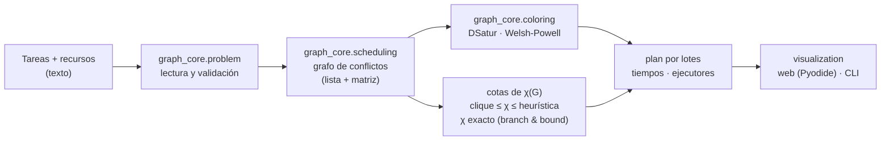

# Asignación de recursos por coloración de grafos

**Matemática Discreta II (FUN-03) · Universidad CENFOTEC · C3-2026 · Tarea 2 · Grupo 2 · Módulo 2**

**App web:** https://djch18atschool.github.io/graph-resource-planner/ (funciona sin instalar nada)

El problema: varias tareas o microservicios necesitan recursos exclusivos (una base de datos, una GPU, un
disco, un estudiante en un examen). Dos tareas que comparten un recurso **no pueden ejecutarse al mismo
tiempo**. ¿Cómo agruparlas en el menor número de **lotes paralelos** sin colisiones?

Se modela como coloración de vértices:

| Grafo | Sistema |
|---|---|
| vértice | tarea / microservicio |
| arista {u, v} | u y v comparten un recurso exclusivo (o se declaró el conflicto) |
| color | lote o *slot* de ejecución paralela libre de colisiones |
| χ(G) (número cromático) | mínimo de lotes posible |



## Qué hace

* **Dos algoritmos de coloración:**
  * **DSatur** (Brélaz, 1979), con heap perezoso: O((V+E) log V). Es exacto en grafos bipartitos, ciclos y
    ruedas.
  * **Welsh-Powell** (1967): O(V log V + k·V + E).
  * Cada ejecución compara ambos.
* **Cotas de χ(G):**
  * La cota inferior es una clique: ω(G) ≤ χ(G). Además, k tareas que comparten un recurso forman un K_k.
  * La cota superior es la mejor heurística, que nunca pasa de Δ(G)+1.
  * χ(G) **exacto** por *branch & bound* en componentes de hasta 60 vértices, o cuando la clique ya iguala a la
    heurística.
* **Plan de ejecución:**
  * Lotes en secuencia; cada lote dura lo que su tarea más larga.
  * Muestra el tiempo total frente al secuencial y los ejecutores necesarios (el lote más grande).
* **Clase `Graph` propia** con lista y matriz de adyacencia sincronizadas. Los algoritmos usan la lista, O(V+E);
  la matriz, O(V²), se muestra en la interfaz.

### La app web

Es un sitio estático (GitHub Pages) que ejecuta **el mismo código Python del repositorio** en el navegador con
[Pyodide](https://pyodide.org) (CPython compilado a WebAssembly), dentro de un Web Worker. No hay servidor ni una
copia del algoritmo en JavaScript.

* **Entrada:**
  * Editor de texto con 4 ejemplos: despliegue de microservicios, horario de exámenes, plataforma de ML y un caso
    difícil para Welsh-Powell.
  * Generador aleatorio G(n, p) para probar con 10, 100 y 1000 nodos.
* **Grafo coloreado:** se puede ver con un layout de fuerzas o **por lotes**. En la vista por lotes cada columna
  es un color y todas las aristas cruzan entre columnas, lo que muestra que la coloración es válida.
* **Paso a paso:** un deslizador y ▶ animan el algoritmo y explican cada decisión. En DSatur se muestran la
  saturación y el grado; en Welsh-Powell, la ronda.
* **Resaltar la clique** que justifica la cota inferior.
* **Pestañas:**
  * Plan por lotes (diagrama de Gantt).
  * Recursos (cada recurso es una clique K_k).
  * Matriz de adyacencia.
  * Tiempos de cada etapa.

### Formato de entrada

```text
titulo: Despliegue nocturno
# Tarea [duración]: recursos exclusivos que usa
Migrar BD pedidos [30]: db_pedidos
Respaldo pedidos [20]: db_pedidos, disco_respaldo
Rotar certificados [5]: balanceador
# conflicto directo, sin recurso compartido:
Desplegar API pagos -- Desplegar frontend
```

## Uso local (con [uv](https://docs.astral.sh/uv/))

```bash
uv sync                                          # crea .venv e instala dependencias (uv.lock)

uv run python main.py demo                       # ejemplo de microservicios
uv run python main.py demo corona --algorithm welsh_powell
uv run python main.py file examples/examenes.txt --out out/examenes --layout batches   # plan.json + grafo.png
uv run python main.py random --n 1000 --p 0.005  # grafo aleatorio G(n, p)
uv run python main.py web                        # construye la app web y la sirve en http://localhost:8000
uv run python main.py stress                     # pruebas de estrés 10 / 100 / 1000 nodos -> results/
```

## Pruebas

```bash
uv run pytest --cov                              # 90+ pruebas unitarias y de integración (~95 % de cobertura)
uv run --group e2e pytest -m e2e                 # E2E: Chromium real cargando Pyodide y usando la app
```

El flujo de GitHub Actions (`.github/workflows/pages.yml`) corre ambas suites en cada *push* y, si pasan,
publica el sitio en GitHub Pages.

## Estructura

| Carpeta | Contenido |
|---|---|
| `graph_core/` | `graph.py`: `Graph` con lista y matriz.<br>`coloring.py`: DSatur, Welsh-Powell, cotas y χ exacto.<br>`problem.py`: tareas y formato de texto.<br>`scheduling.py`: grafo de conflictos y plan por lotes.<br>`generators.py`: grafos de prueba. |
| `visualization/` | `web/`: HTML, CSS, JS y Web Worker.<br>`web_api.py` y `view_model.py`: puente Python ↔ web.<br>`cli.py`.<br>`plotting.py`: matplotlib. |
| `benchmarks/stress.py` | Pruebas de estrés (CSV, JSON y PNG en `results/`). |
| `scripts/build_web.py` | Empaqueta el código Python y la web en `dist/`, que es lo que se publica. |
| `examples/` | Problemas de ejemplo en formato de texto. |
| `docs/ARQUITECTURA.md` | Complejidad, arquitectura y pruebas de estrés para el documento PDF. |
| `tests/` | pytest, con las pruebas de navegador en `tests/e2e`. |

## Ventajas y desventajas (para el video)

**Ventajas**
* DSatur y Welsh-Powell son casi lineales en grafos dispersos: 1000 tareas se colorean en ~3 ms.
* Las cotas indican cuándo el resultado es **óptimo demostrado**. Cuando la clique iguala a la heurística, no
  hace falta adivinar.
* La vista paso a paso y la vista por lotes hacen visible la matemática.

**Desventajas y limitaciones**
* Ambas son heurísticas: calcular χ(G) es NP-difícil. En grafos aleatorios densos de 1000 nodos queda una
  brecha entre la cota inferior (4) y DSatur (16).
* Welsh-Powell depende del orden de los vértices: en el grafo corona usa 5 lotes cuando bastan 2.
* El modelo supone recursos de capacidad 1. No modela recursos con varias unidades (3 GPU iguales) ni
  dependencias de orden entre tareas.
* La coloración minimiza el número de lotes, no el tiempo total: con duraciones distintas, el mínimo de lotes
  no siempre da el menor tiempo (coloración ponderada).
* La primera carga de la web descarga Pyodide (~10 MB, luego queda en caché del navegador).

## Integrantes (Grupo 2)

* _Nombre 1_
* _Nombre 2_
* _Nombre 3_
* _Nombre 4_
