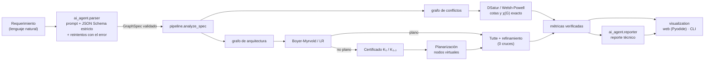

# Motor IA de planificación y orquestación basado en grafos

**Matemática Discreta II (FUN-03) · Universidad CENFOTEC · C3-2026 · Tarea 2 · Grupo 2**

**App web:** https://djch18atschool.github.io/graph-resource-planner/ (funciona sin instalar nada; el modo *offline* no necesita API key)

Un agente LLM convierte un requerimiento en lenguaje natural en un **grafo de recursos** (JSON validado).
Sobre ese grafo corren algoritmos **deterministas**: **coloración** (lotes de ejecución en paralelo sin
conflictos) y **planaridad** (diagrama de arquitectura sin cruces de aristas). El LLM vuelve a intervenir solo
para **interpretar** las métricas en un reporte técnico. *El LLM nunca calcula; los algoritmos nunca adivinan.*



## Cómo se cumple cada módulo de la consigna

| Módulo | Implementación | Archivo |
|---|---|---|
| **1. Representación** | Clase `Graph` propia con **lista y matriz de adyacencia sincronizadas**; agregar/eliminar vértices y aristas, grados, exportación a JSON y NetworkX; cada consulta elige `backend="list" \| "matrix"` para comparar O(V+E) vs O(V²). | `graph_core/graph.py` |
| **2. Coloración** | **DSatur** (heap perezoso, O((V+E) log V)) y **Welsh-Powell**; cota inferior por clique (ω(G) ≤ χ(G)); χ(G) **exacto** por *branch & bound* en componentes pequeñas. Color = lote de ejecución paralela. | `graph_core/coloring.py` |
| **3. Grafos planos** | Test de planaridad (Left-Right, equivalente a Boyer-Myrvold), **certificado de Kuratowski** (subgrafo mínimo K₅ / K₃,₃ con QuickXplain), **planarización con nodos virtuales** (inserción por el grafo dual + *rip-up & reroute*) y **dibujo plano de Tutte** con refinamiento por fuerzas que preserva la planaridad. | `graph_core/planarity.py`, `graph_core/drawing.py` |
| **4. IA generativa** | Claude (SDK oficial) u Ollama. **Structured output** con `output_config.format` (JSON Schema estricto derivado de Pydantic), validación + reintentos devolviendo el error al modelo, y reporte que interpreta χ(G) y la planaridad con un bloque de **datos verificados** generado por código. | `ai_agent/` |

## La app web (GitHub Pages)

La interfaz es un sitio estático que ejecuta **el mismo código Python del repositorio** en el navegador con
[Pyodide](https://pyodide.org) (CPython compilado a WebAssembly), dentro de un Web Worker. No hay servidor ni una
versión del algoritmo reescrita en JavaScript.

* **Entrada:** texto libre, ejemplos incluidos o un `GraphSpec` en JSON editable.
* **Proveedor:** *offline* (ejemplos por palabras clave, sin red), **Claude** (cada usuario ingresa su API key; se
  usa solo desde su navegador hacia `api.anthropic.com` y nunca se guarda en el repositorio) u **Ollama** local.
* **Resultados:** dibujo plano interactivo (colores = lotes, rojo punteado = conflictos, rombos = nodos virtuales),
  comparación con un layout de fuerzas que sí cruza aristas, resaltado del certificado de Kuratowski, plan de
  ejecución por lotes, reporte técnico, JSON del LLM, matriz de adyacencia y tiempos de cada algoritmo.

Para usar **Ollama** desde la web, inícielo permitiendo el origen de la página:
`OLLAMA_ORIGINS=https://djch18atschool.github.io ollama serve`.

## Instalación local (con [uv](https://docs.astral.sh/uv/))

```bash
uv sync                                     # crea .venv e instala dependencias (uv.lock)
cp .env.example .env                        # opcional: ANTHROPIC_API_KEY, LLM_PROVIDER, ...

uv run python main.py demo ml               # ejemplo no plano (K3,3), sin API key
uv run python main.py demo ecommerce --out out/ecommerce    # spec.json, analysis.json, graph.png, report.md
uv run python main.py analyze "Crea una arquitectura de microservicios para un e-commerce con pagos, inventario y notificaciones en tiempo real" --provider anthropic
uv run python main.py file examples/pipeline.json
uv run python main.py interactive           # CLI interactiva (REPL)
uv run python main.py web                   # construye la app web y la sirve en http://localhost:8000
uv run python main.py stress                # pruebas de estrés 10 / 100 / 1000 nodos -> results/
```

Opciones comunes: `--provider anthropic|ollama|offline`, `--model`, `--algorithm dsatur|welsh_powell`,
`--layout planar|spring`, `--no-report`, `--show`. El modelo por defecto de Claude es `claude-opus-5-5`
(`ANTHROPIC_MODEL` / `ANTHROPIC_EFFORT` para cambiarlo).

## Pruebas

```bash
uv run pytest --cov                         # 120+ pruebas unitarias y de integración (cobertura ~95%)
uv run --group e2e pytest -m e2e            # E2E: Chromium real cargando Pyodide y usando la app
```

El flujo de GitHub Actions (`.github/workflows/pages.yml`) corre ambas suites en cada *push* y, si pasan,
publica el sitio en GitHub Pages.

## Estructura

| Carpeta | Contenido |
|---|---|
| `graph_core/` | `graph.py` (Graph lista + matriz) · `coloring.py` (DSatur, Welsh-Powell, cotas, χ exacto) · `planarity.py` (planaridad, Kuratowski, planarización) · `drawing.py` (Tutte + refinamiento plano) |
| `ai_agent/` | `prompts.py` · `schemas.py` (contrato JSON y esquema estricto) · `llm_client.py` (Claude / Ollama / offline) · `browser_client.py` (mismo protocolo vía JavaScript) · `parser.py` · `reporter.py` |
| `visualization/` | `web/` (HTML, CSS, JS, Web Worker) · `web_api.py` y `view_model.py` (puente Python ↔ web) · `cli.py` · `plotting.py` (matplotlib) |
| `pipeline.py` | Orquestador: la única capa que conoce a `ai_agent` y `graph_core` |
| `benchmarks/` | Generadores de grafos y pruebas de estrés (CSV/JSON/PNG en `results/`) |
| `scripts/build_web.py` | Empaqueta el código Python + la web en `dist/` (lo que se publica) |
| `tests/` · `examples/` · `docs/` | pytest (+ `tests/e2e`) · JSON de ejemplo · notas para el documento PDF |

## Contrato JSON (salida estructurada del LLM)

```json
{"title": "...",
 "nodes": [{"id": "payment-service", "label": "Pagos", "type": "service", "description": "Cobra las órdenes"}],
 "edges": [{"source": "checkout", "target": "payment-service", "kind": "dependency", "reason": "cobra"},
           {"source": "backup-job", "target": "order-service", "kind": "conflict", "reason": "bloquea orders-db"}]}
```
* `conflict` = recurso compartido, no pueden ejecutarse a la vez → **aristas que se colorean** (color = lote).
* `dependency` + `conflict` = **diagrama de arquitectura** → grafo que se prueba para planaridad y se dibuja.

## Decisiones de diseño

* **Dos grafos desde un mismo JSON:** el de conflictos (coloración) y el de arquitectura (planaridad).
* **Structured output real:** el esquema estricto (`GraphSpec.llm_schema()`) se envía como
  `output_config.format`; lo que la API no admite (p. ej. máximo 60 nodos) lo valida Pydantic y, si falla, se
  reintenta devolviendo el error al modelo. (El `tool_choice` forzado ya no lo aceptan los modelos actuales.)
* **Un solo código Python en terminal y navegador:** `ai_agent` es asíncrono; en la web, Python arma la petición y
  un puente JavaScript solo la transporta (SDK oficial `@anthropic-ai/sdk` o `fetch` para Ollama).
* **Anti-alucinación:** todo reporte termina con un bloque «Datos verificados» generado por código.
* **Anti-inyección:** el texto del usuario va delimitado como dato en `<requerimiento>…</requerimiento>`; el
  reporte Markdown del LLM se sanitiza con DOMPurify antes de mostrarse.
* **Dibujo plano legible:** el embedding de rejilla (de Fraysseix–Pach–Pollack) garantiza 0 cruces pero aplasta
  los triángulos; se usa el teorema de Tutte (baricentros) + Fruchterman-Reingold que rechaza todo movimiento que
  cree un cruce, verificado por un contador de cruces independiente (con respaldo al dibujo de rejilla).
* **Determinismo:** adyacencia en `dict` de inserción ordenada → mismos resultados en cada ejecución.

## Limitaciones conocidas

* DSatur/Welsh-Powell son heurísticas (cota superior de χ(G)); el valor exacto solo se calcula en componentes
  de ≤ 60 vértices (el problema es NP-difícil).
* La planarización es heurística (el *crossing number* es NP-difícil): K₆ → 3 cruces y K₇ → 9 (óptimos), pero no
  garantiza el mínimo en general. En grafos densos de cientos de nodos se corta por `time_limit`.
* La coloración ignora el orden de las dependencias: los lotes evitan conflictos, no secuencian dependencias.
* La primera carga de la web descarga Pyodide (~10–15 MB, luego queda en caché del navegador).
* Con un proveedor real, la calidad del grafo depende del LLM; el modo offline solo elige entre 3 ejemplos.

## Integrantes (Grupo 2)

* _Nombre 1_
* _Nombre 2_
* _Nombre 3_
* _Nombre 4_
