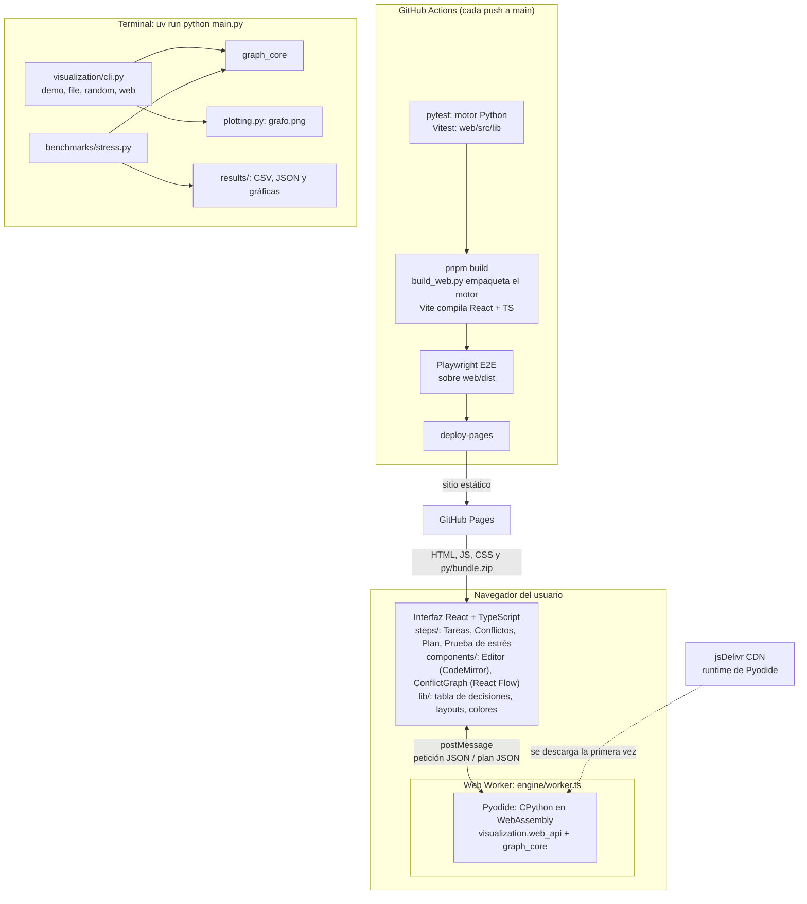
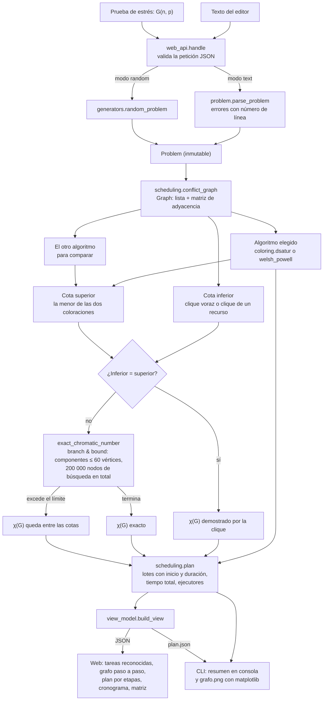
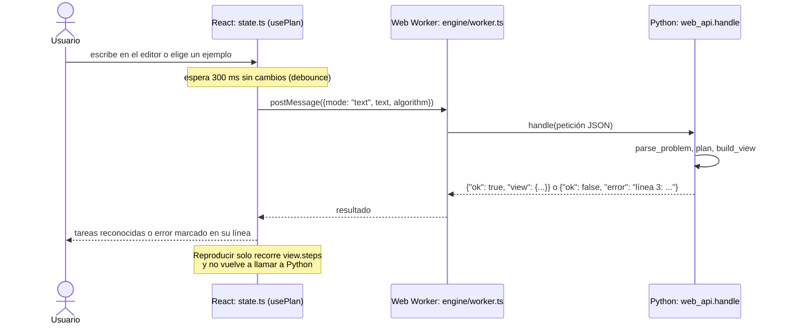

# Notas para el Documento de Investigación y Arquitectura (PDF)

Material de apoyo para las tres secciones que pide la consigna: complejidad teórica de los algoritmos,
diagrama de arquitectura y pruebas de estrés con 10, 100 y 1000 nodos. Las cifras de la sección 3 salen de
`results/`, generado con `uv run python main.py stress`.

## 1. Modelo matemático

Sea T el conjunto de tareas y R el de recursos exclusivos; cada tarea t usa un subconjunto rec(t) ⊆ R.

* **Grafo de conflictos.** G = (T, E) con {u, v} ∈ E si rec(u) ∩ rec(v) ≠ ∅, o si el conflicto se declaró
  explícitamente.
* **Coloración propia.** c : T → {1, …, k} con c(u) ≠ c(v) para toda arista. Cada clase de color es un
  **conjunto independiente**, es decir, tareas sin conflictos entre sí: un lote que corre en paralelo.
* **Objetivo.** Minimizar k. El mínimo es el **número cromático** χ(G), y decidir si χ(G) ≤ k es NP-completo
  para k ≥ 3 (Karp, 1972).
* **Cotas usadas:**
  * **Inferior:** ω(G) ≤ χ(G), porque una clique necesita un color por vértice. Si un recurso r lo usan k
    tareas, esas tareas forman K_k, así que χ(G) ≥ max_r |usuarios(r)|.
  * **Superior:** cualquier coloración voraz usa como mucho Δ(G)+1 colores. Por el teorema de Brooks,
    χ(G) ≤ Δ(G) salvo en grafos completos y ciclos impares.
  * **Óptimo demostrado:** si la clique encontrada iguala a la mejor heurística, ese valor es χ(G). En
    componentes de hasta 60 vértices se calcula además χ(G) exacto por *branch & bound*.
* **Plan.** Los lotes corren en secuencia y el lote i dura max{dur(t) : c(t) = i}. Tiempo total =
  Σ duración de los lotes; ejecutores necesarios = tamaño del lote más grande.

## 2. Diagrama de arquitectura

### 2.1 Componentes y despliegue

El mismo paquete `graph_core` corre en los dos entornos: en la terminal con CPython y en el navegador con
Pyodide. La interfaz no reimplementa ningún algoritmo. Recibe el plan ya calculado (incluida la lista de pasos
del algoritmo) y solo lo dibuja; la tabla de decisiones de cada paso se reconstruye en `lib/decisions.ts` a
partir de esos pasos, y las pruebas de Vitest comprueban contra la salida real de Python que coincide.

### 2.2 Flujo de datos

### 2.3 Secuencia de una petición en la web

**Principios:**
* `graph_core` no conoce la interfaz.
* El mismo código Python corre en la terminal y en el navegador.
* Las estructuras de dominio (`Task`, `Problem`, `Batch`, `Plan`) son inmutables (`dataclass(frozen=True)`).
* La adyacencia usa `dict` con orden de inserción, así los resultados son deterministas.

## 3. Complejidad (V vértices, E aristas, d grado, k colores, k_r usuarios del recurso r)

| Componente | Tiempo | Espacio | Nota |
|---|---|---|---|
| Lista de adyacencia | add_edge/has_edge O(1), neighbors O(d), degree O(1) | O(V+E) | `dict` de inserción ordenada |
| Matriz de adyacencia | add_edge/has_edge O(1), neighbors/degree O(V), add/remove vértice O(V) | O(V²) | remove con *swap-with-last* |
| Lectura del texto | O(L) | O(V + Σ\|rec(t)\|) | L = largo del texto |
| Grafo de conflictos | O(V + Σ_r k_r²) | O(V+E) | cada recurso aporta una clique K_{k_r} |
| **DSatur** (heap perezoso) | **O((V+E) log V)** | O(V+E) | cada arista causa a lo sumo un *push* |
| **Welsh-Powell** | **O(V log V + k·V + E)** ≤ O(V²) | O(V) | k rondas, cada una recorre la lista ordenada |
| Validar coloración | O(V+E) | O(1) | |
| Clique voraz (cota inferior) | O(s·V·d) | O(V) | s = 25 vértices de inicio |
| χ(G) exacto (B&B) | exponencial en el peor caso | O(V) | solo componentes ≤ 60 vértices; 200 000 nodos de búsqueda en total |
| Plan por lotes | O(V) | O(V) | |

**¿Por qué DSatur es O((V+E) log V)?** La saturación de un vértice solo crece cuando un vecino recibe un
color nuevo para él. Cada arista provoca entonces a lo sumo una inserción en el heap, y las entradas obsoletas
se descartan al extraerlas. En total hay O(V + E) operaciones de heap de O(log V) cada una.

**Lista vs matriz (O(V+E) vs O(V²)).** Ambos algoritmos recorren los vecinos de cada vértice:
* Con la lista, eso es O(d) por vértice y O(V+E) en total.
* Con la matriz, es O(V) por vértice y O(V²) en total, aunque el grafo sea disperso.

En problemas reales cada tarea choca con pocas otras (E = O(V)), así que la lista gana en tiempo y en memoria.
La matriz solo compite cuando el grafo es denso o cuando dominan las consultas `has_edge`, que son O(1) en
ambas.

## 4. Pruebas de estrés (10, 100 y 1000 nodos)

Ver `results/stress_results.csv` y las gráficas `results/stress_times.png`, `stress_colors.png`,
`stress_ops.png` y `stress_memory.png`.

Corrida incluida: CPython 3.12, una sola máquina; mejor de 3 ejecuciones, tiempos en milisegundos. En la columna
χ(G), «-» significa que no se pudo demostrar el óptimo.

| Familia | n | E | Δ | DSatur ms / lotes | Welsh-Powell ms / lotes | Clique | χ(G) |
|---|---|---|---|---|---|---|---|
| Triangulación plana | 10 | 24 | 8 | 0.02 / 4 | 0.01 / 4 | 4 | 4 |
| Triangulación plana | 100 | 294 | 36 | 0.24 / 4 | 0.11 / 5 | 4 | 4 |
| Triangulación plana | 1000 | 2994 | 121 | 3.91 / **4** | 1.45 / 6 | 4 | 4 |
| Grilla (bipartita) | 1000 | 1860 | 4 | 1.68 / 2 | 0.88 / 2 | 2 | 2 |
| Aleatorio disperso | 100 | 200 | 10 | 0.29 / 4 | 0.14 / 4 | 3 | - |
| Aleatorio disperso | 1000 | 2000 | 11 | 2.37 / 4 | 1.17 / 4 | 3 | - |
| Aleatorio denso | 100 | 1485 | 43 | 0.61 / 11 | 0.26 / 14 | 6 | - |
| Aleatorio denso | 1000 | 24975 | 71 | 14.17 / 16 | 6.09 / 19 | 4 | - |
| Recursos compartidos | 10 | 39 | 9 | 0.03 / 8 | 0.02 / 8 | 8 | 8 |
| Recursos compartidos | 100 | 937 | 26 | 0.56 / 15 | 0.21 / 15 | 15 | 15 |
| Recursos compartidos | 1000 | 9959 | 33 | 8.35 / 20 | 2.98 / 20 | 20 | 20 |

### Lectura de los resultados

* **Escalabilidad.** De 100 a 1000 nodos (×10) el tiempo crece entre ×8 y ×23, lo esperado para
  O((V+E) log V) y O(kV + E). Por ejemplo, la triangulación pasa de 0.24 a 3.91 ms (×16), con E creciendo ×10.
  Ni con 25 000 aristas se llega a 15 ms.
* **Calidad.**
  * DSatur nunca usa más lotes que Welsh-Powell.
  * En las triangulaciones planas DSatur respeta el **Teorema de los Cuatro Colores** (4 lotes con 1000 nodos)
    y Welsh-Powell usa 6.
  * Ambos son exactos en la grilla bipartita (χ = 2).
* **Óptimo demostrado.** En las familias «recursos compartidos» y en las triangulaciones, la clique iguala a
  DSatur, así que ese valor **es** χ(G) aunque el grafo tenga 1000 vértices.
* **Límite honesto.** En el grafo aleatorio denso de 1000 nodos queda una brecha 4 ≤ χ ≤ 16. La clique voraz es
  una cota débil en grafos aleatorios y calcular χ es NP-difícil; con este tamaño el *branch & bound* no
  termina.
* **Velocidad.** Welsh-Powell es unas 2 veces más rápido que DSatur porque no mantiene el heap de saturaciones.
  DSatur compensa con mejor calidad.
* **Lista vs matriz** (`stress_representations.csv`, E = 3V):
  * Con V = 3000 la lista ocupa **1.1 MB** y se construye en 4 ms; la matriz ocupa **72 MB** y tarda ~50 ms (10 veces más).
  * De V = 100 a V = 3000 (×30), la memoria de la matriz crece ×877 ≈ 30², es decir, de forma cuadrática. La de
    la lista crece ×38 ≈ 30, es decir, de forma lineal.
  * Recorrer los vecinos de los 1000 vértices tarda ~0.4 ms con la lista y ~15 ms con la matriz (unas 35 veces más).
* **En el navegador (Pyodide / WebAssembly)**, con G(1000, 0.005) en Chrome: construir el grafo tarda 25 ms,
  DSatur 6.5 ms, Welsh-Powell 2.7 ms y las cotas 1.1 ms. Es unas 2 veces más lento que CPython nativo y sigue
  siendo instantáneo para el usuario. Se puede comprobar con el botón «1000 nodos» y la pestaña «Tiempos».

## 5. Verificación de calidad

* 100+ pruebas del motor (`uv run pytest --cov`, ~95 % de cobertura), pruebas de la lógica de la interfaz con
  Vitest (verifican contra la salida real de Python que la tabla de decisiones coincide con el algoritmo en cada
  paso) y 7 pruebas E2E en Chromium con Pyodide.
* Propiedades verificadas:
  * Toda coloración es propia.
  * Los lotes particionan las tareas.
  * Los pasos registrados coinciden con el resultado.
  * La saturación registrada por DSatur es correcta.
  * χ exacto coincide con la fuerza bruta en grafos pequeños.
  * Valores conocidos: Petersen 3, K₆ 6, Grötzsch 4 con ω = 2.
* Validación de entrada con mensajes por línea, límites de tamaño (2000 tareas y 100 000 conflictos) y errores
  genéricos sin trazas en la interfaz.

## 6. Ideas para la sección de indagación

* Coloración y planificación:
  * Brélaz, *New methods to color the vertices of a graph* (1979), sobre DSatur.
  * Welsh & Powell (1967).
  * Teorema de Brooks (1941).
  * Teorema de los Cuatro Colores (Appel–Haken, 1976).
  * Karp (1972): coloración NP-completa.
  * Grafos de Mycielski, donde ω = 2 y χ es arbitrario.
  * Aplicaciones a la asignación de registros en compiladores (Chaitin, 1982), horarios de exámenes y
    asignación de frecuencias.
* Variantes:
  * Coloración ponderada, para minimizar el tiempo total con duraciones.
  * Coloración equitativa, para balancear el tamaño de los lotes.
  * Recursos con capacidad mayor a 1, que lleva a planificación con restricciones (RCPSP).
