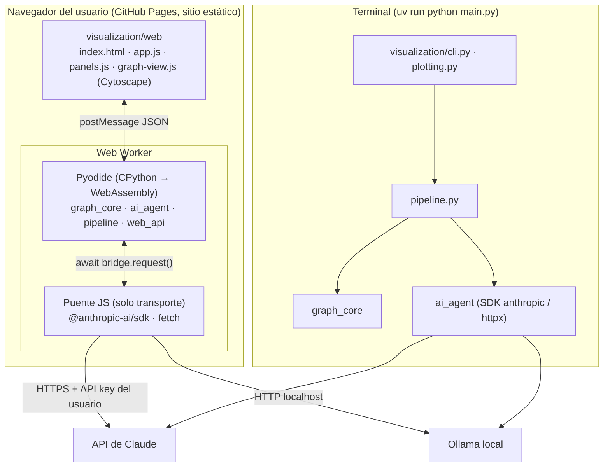
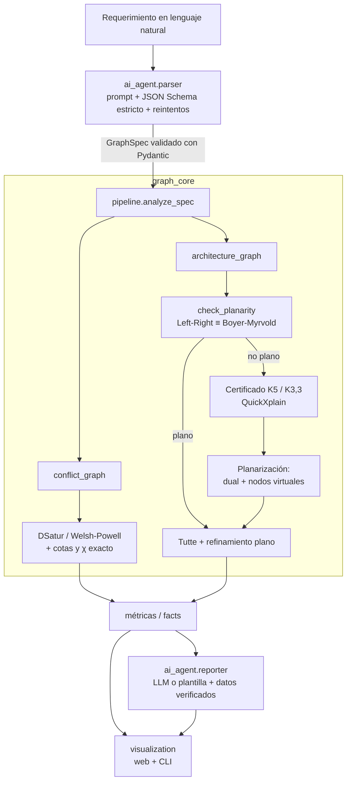

# Notas para el Documento de Investigación y Arquitectura (PDF)

Material de apoyo para las tres secciones que pide la consigna: complejidad teórica, diagrama de arquitectura y
pruebas de estrés (10, 100 y 1000 nodos). Las cifras de la sección 3 salen de `results/` (`uv run python main.py stress`).

## 1. Diagrama de arquitectura

### 1.1 Componentes y despliegue

### 1.2 Flujo de datos

**Principios:** el LLM traduce (texto → JSON) e interpreta (métricas → reporte) pero nunca calcula; `pipeline.py`
es la única capa que conoce a `ai_agent` y `graph_core`; el mismo código Python corre en terminal y en el navegador
(la capa `ai_agent` es asíncrona para poder esperar promesas de JavaScript dentro de Pyodide).

## 2. Complejidad (V vértices, E aristas, d grado, k colores, c aristas con cruces)

| Componente | Tiempo | Espacio | Nota |
|---|---|---|---|
| Lista de adyacencia | add_edge/has_edge O(1), neighbors O(d), degree O(1) | O(V+E) | `dict` de inserción ordenada |
| Matriz de adyacencia | add_edge/has_edge O(1), neighbors/degree O(V), add/remove vértice O(V) | O(V²) | remove con *swap-with-last* |
| DSatur (heap perezoso) | O((V+E) log V) | O(V+E) | exacto en bipartitos, ciclos y ruedas |
| Welsh-Powell | O(V log V + kV + E) ≤ O(V²) | O(V) | |
| Cota inferior (clique voraz) | O(s·V·d) | O(V) | ω(G) ≤ χ(G) |
| χ(G) exacto (B&B) | exponencial | O(V) | solo componentes ≤ 60 vértices; NP-difícil |
| Test de planaridad | O(V+E) (E ≤ 3V−6 si es plano) | O(V+E) | NetworkX (Left-Right, equivalente a Boyer-Myrvold) |
| Embedding en rejilla | O(V) (de Fraysseix–Pach–Pollack) | O(V) | rejilla (2V−4)×(V−2); respaldo siempre plano |
| Certificado de Kuratowski | O(k·log(E/k)) tests de planaridad | O(E) | QuickXplain; k = tamaño del certificado |
| Planarización | O((c + log E)·(V+E)) + reinserción | O(V+E) | heurística; *crossing number* NP-difícil |
| Dibujo de Tutte | O(V) triangulación + O(V³) sistema lineal | O(V²) | numpy; V del grafo planarizado (pequeño) |
| Refinamiento plano | O(V² + E²) por iteración | O(V+E) | iteraciones = min(300, 1.5·10⁶ / E²) |
| Verificación de cruces | O(E log E + P) (barrido en x) | O(E) | independiente del algoritmo de dibujo |

**Reto de ingeniería (O(V+E) vs O(V²)).** En grafos de arquitectura E = O(V) (pocas dependencias por servicio; si
es plano E ≤ 3V−6 por la fórmula de Euler). Con V = 3000 y E = 3V la lista ocupa ~1 MB frente a ~72 MB de la
matriz (`results/stress_representations.csv`). La matriz solo gana si el grafo es denso o si dominan las consultas
`has_edge` (ambas O(1)); para recorrer vecinos (lo que hacen DSatur y la planaridad) la lista es O(d) y la matriz
O(V). Por eso los algoritmos usan la lista y la matriz se conserva para mostrar A en la interfaz.

**Justificación de los algoritmos de dibujo.**
* *Teorema de Tutte (1963):* si G es plano y 3-conexo, fijar la cara externa como polígono convexo y colocar cada
  vértice interno en el baricentro de sus vecinos produce un dibujo plano con caras convexas. Se triangula el
  embedding (salvo la cara externa) para cumplir la hipótesis y las aristas auxiliares no se dibujan.
* *Refinamiento:* Fruchterman–Reingold (1991) con dos cambios: repulsión vértice-arista y rechazo de todo
  movimiento que cree un cruce (con *backtracking* a ½ y ¼ del paso). Invariante: el dibujo es plano antes y
  después de cada paso. Idea basada en ImPrEd (Simonetto et al., 2011).

## 3. Pruebas de estrés (10, 100 y 1000 nodos)

Ver `results/stress_results.csv` y las gráficas `results/stress_times.png`, `stress_ops.png`, `stress_memory.png`.

Corrida incluida (CPython 3.12, una sola máquina; tiempos en milisegundos salvo la planarización):

| Familia | n | E | DSatur ms / colores | Welsh-Powell ms / colores | Planaridad ms | ¿Plano? | Cruces (nodos virtuales) |
|---|---|---|---|---|---|---|---|
| Triangulación plana | 10 | 24 | 0.02 / 4 | 0.01 / 4 | 1.4 | Sí | 0 |
| Triangulación plana | 100 | 294 | 0.29 / 4 | 0.12 / 5 | 7.3 | Sí | 0 |
| Triangulación plana | 1000 | 2994 | 2.97 / **4** | 1.07 / 6 | 45.3 | Sí | 0 |
| Grilla (bipartita) | 1000 | 1860 | 1.56 / 2 | 1.11 / 2 | 62.0 | Sí | 0 |
| Casi plano (+n/20) | 100 | 299 | 0.22 / 5 | 0.08 / 5 | 18.2 | No | 54 (0.42 s) |
| Casi plano (+n/20) | 1000 | 3044 | 2.94 / 5 | 1.14 / 6 | 350.7 | No | 1711 (30 s, límite) |
| Aleatorio disperso | 100 | 200 | 0.16 / 4 | 0.07 / 4 | 40.9 | No | 373 (8.6 s) |
| Aleatorio denso | 100 | 1485 | 0.60 / 11 | 0.21 / 14 | 30.3 | No | límite de 30 s |
| Aleatorio denso | 1000 | 24975 | 13.44 / 16 | 5.91 / 19 | 159.6 | No | límite de 30 s |

Lectura de los resultados:
* **Coloración:** escala casi lineal (≈10× tiempo por 10× nodos) como predice O((V+E) log V). DSatur nunca usa
  más colores que Welsh-Powell y en las triangulaciones respeta el Teorema de los Cuatro Colores (4 colores con
  1000 nodos, Welsh-Powell usa 6). Ambas son exactas en la grilla bipartita (χ = 2).
* **Planaridad:** el test es O(V+E): 45 ms para 1000 nodos planos. En grafos no planos el tiempo extra es el
  certificado de Kuratowski (QuickXplain hace O(k log(E/k)) tests).
* **Planarización:** es la etapa cara (heurística para un problema NP-difícil). Termina en < 1 s en grafos casi
  planos de 100 nodos —el caso realista de una arquitectura— y se corta por `time_limit` en grafos densos, donde
  dibujar sin cruces deja de ser útil (miles de nodos virtuales). La app avisa cuando quedan aristas sin dibujar.
* **Lista vs matriz** (`stress_representations.csv`, E = 3V): con V = 3000 la lista ocupa **1.1 MB** y se
  construye en 5 ms; la matriz ocupa **72 MB** y tarda 30 ms. De V = 100 a V = 3000 (×30) la memoria de la
  matriz crece ×877 ≈ 30² (cuadrática) y la de la lista ×38 ≈ 30 (lineal).

## 4. Verificación de calidad

* 130+ pruebas automáticas (`uv run pytest --cov`, ~95 % de cobertura) y 5 pruebas E2E en Chromium con Pyodide.
* Propiedades verificadas: toda coloración es válida, todo dibujo final tiene 0 cruces (contador independiente),
  la planarización conserva cada arista original como un camino, y los certificados son K5 o K3,3 mínimos.
* Regresión detectada en la revisión de código: el *rip-up & reroute* de la base fallaba en ~10 % de los grafos
  aleatorios no planos (se recreaba una arista paralela). Corregido y verificado en 420 grafos aleatorios.

## 5. Ideas para la sección de indagación
Teorema de Kuratowski; Boyer–Myrvold (2004); Euler (E ≤ 3V−6); Teorema de los Cuatro Colores; Brooks (χ ≤ Δ+1);
Brélaz (DSatur, 1979); Welsh & Powell (1967); QuickXplain (Junker, 2004); de Fraysseix–Pach–Pollack (1990);
Tutte, *How to draw a graph* (1963); Fruchterman & Reingold (1991); planarización y *edge insertion* con embedding
fijo (Gutwenger & Mutzel); salida estructurada de LLMs con JSON Schema.
